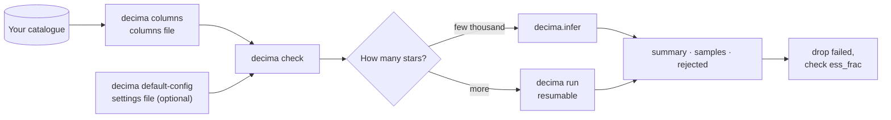

# DECIMA

Decima is the Roman Fate who measures the thread of life. DECIMA is also Distance, Extinction and Chronometry via Isochrone Modelling via Amortised Inference.

It infers a star's **age**, distance and extinction, together with its initial [Fe/H], [α/Fe] and evolutionary stage, from spectroscopic T_eff and [Fe/H] (and [α/Fe]), a Gaia parallax, and Gaia and 2MASS photometry. Neural posterior estimation on MIST isochrones, then importance sampling over every band and the exact parallax likelihood ([how it works](docs/explanation/method.md)).

**Documentation: <https://teresa-su.github.io/decima/>** (or the `docs/` folder). Start with the [tutorial](docs/tutorial.ipynb).

## Install

```bash
git clone https://github.com/teresa-su/decima && cd decima
uv sync                 # or: pip install -e .
```

Python ≥ 3.10. The trained models ([doi:10.5281/zenodo.24584265](https://doi.org/10.5281/zenodo.24584265), CC-BY-4.0, 245 MB) are downloaded from Zenodo the first time DECIMA needs them and cached (`~/.cache/decima/v1` on Linux). If your compute nodes have no internet, run `decima download-models` on the login node first. To keep the models elsewhere, or use a copy you already have, set `DECIMA_DATA_DIR` to that directory.

## The workflow



Two small JSON files steer a run, and they are different things: the **columns file** maps *DECIMA's column names to yours*; the **settings file** holds every setting that changes the result. Neither is needed if your table already uses [DECIMA's names](docs/reference/inputs.md) and you are happy with the defaults.

```bash
decima columns stars.fits -o cols.json                        # suggest the columns file; check it
decima check   stars.fits --columns cols.json                 # catches wrong names, units and settings in seconds
decima run     stars.fits --columns cols.json --out run/ --workers 16    # resumable: re-run the same command
```

or in Python, for a few thousand stars:

```python
import decima

columns = dict(decima.suggest_columns("docs/data/example_stars.ecsv"))
summary, samples, rejected = decima.infer("docs/data/example_stars.ecsv", columns)
summary["id", "age_p16", "age_p50", "age_p84", "failed", "ess_frac"]
```

`suggest_columns` and `check_inputs` need no models:

```python
import decima

report = decima.check_inputs("docs/data/example_stars.ecsv", decima.suggest_columns("docs/data/example_stars.ecsv"))
print(report.ok, report.n_run, "of", report.n_rows, "stars can be run")
```

## Output

- **`summary`:** one row per star run. Percentiles (5, 16, 50, 84, 95) of `age` [Gyr], `distance` [pc], the extinction, `feh_init`, `alpha_fe_init`, `log_age` and `eep`, plus quality flags. **`failed`** and **`ess_frac`** are the ones to filter on.
- **`samples`:** (n_stars, n_keep, 7) unweighted posterior draws.
- **`rejected`:** input rows that could not be run, and why.

`decima run` writes `summary.fits`, `samples.h5` and `rejected.ecsv` into the run directory. [What every column means](docs/reference/outputs.md), and [which results to trust](docs/how-to/trust-results.md).

## Validated domain and known limitations

DECIMA can be run on any star with the required inputs.

**Trained on** a uniform prior over the MIST v2.5 grid:

| Parameter | Range |
|---|---|
| [Fe/H] | −4 to +0.5 |
| [α/Fe] | −0.2 to +0.6 |
| age | 10⁵ yr to 20 Gyr (uniform in linear age) |
| EEP | ZAMS (202) to end of core-He burning (707) |

So the training covers the main sequence, turn-off, subgiant branch, red giant branch, red clump and horizontal branch.

**Validated on:**
- **Mock stars** from that prior (no extinction), against nested sampling. Posterior coverage is close to nominal: 5.6–7.7% of true values fall outside the 95% interval, against 5% nominal.
- **Real stars:** the Xiang+24 LAMOST catalogue of turn-off and subgiant stars (≈250,000 single stars). These have T_eff ≈ 5000–6650 K, log g ≈ 3.35–4.3 and [Fe/H] ≈ −1.7 to +0.3. Against the catalogue ages, the residuals have mean +0.2 Gyr and RMS 1.05 Gyr.

**Known weaknesses:**
- **Binaries:** unresolved binaries are not modelled.
- **Failures:** on the Xiang+24 catalogue, 0.1% of stars fail (see Output above).

## Development

```bash
uv sync --group docs
uv run pytest                                              # all tests (the model-dependent ones are skipped without the models)
DECIMA_DATA_DIR=/path/to/models uv run pytest              # all tests, models elsewhere
uv run pytest --nbmake docs/how-to/config-files.ipynb      # the notebooks run (the tutorial needs the models)
uv run python docs/gen_reference.py                        # regenerate the reference tables after changing Config or the columns
uv run mkdocs serve                                        # preview the site
```

To change a notebook, edit its paired `.py` file, then `cd docs && jupytext --to ipynb --execute tutorial.py how-to/config-files.py`.

## Licence

BSD-3-Clause.
