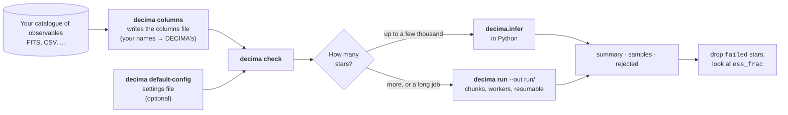

# DECIMA

Stellar ages, distances and extinctions, with initial [Fe/H], [α/Fe] and evolutionary stage, from spectroscopy plus Gaia and 2MASS photometry. Fast neural posterior estimation on MIST isochrones, then importance sampling that uses every band and the exact parallax likelihood.

You need, for each star: spectroscopic T_eff and [Fe/H] (and [α/Fe], otherwise assumed solar), a Gaia parallax, a Ks magnitude (more bands help), and a sky position.

## The workflow



## Start here

| I want to… | Read |
|---|---|
| See it work on a few stars | [Tutorial](tutorial.ipynb) |
| Make the columns file and the settings file | [Make your columns file and settings file](how-to/config-files.ipynb) |
| Run it on a large catalogue of stars, on a cluster or a GPU | [Run a large catalogue](how-to/large-runs.md) |
| Know which results are robust | [Decide which results to trust](how-to/trust-results.md) |
| Look up a column, a setting, an output | [Reference](reference/inputs.md) |
| Understand what DECIMA does | [How DECIMA works](explanation/method.md) |

## Install

```bash
git clone https://github.com/teresa-su/decima && cd decima
uv sync                 # or: pip install -e .
```

Python ≥ 3.10. The trained models ([doi:10.5281/zenodo.24584265](https://doi.org/10.5281/zenodo.24584265), CC-BY-4.0, 245 MB) are downloaded from Zenodo the first time DECIMA needs them and cached (`~/.cache/decima/v1` on Linux). If your compute nodes have no internet, run `decima download-models` on the login node first. To keep the models elsewhere, or use a copy you already have, set `DECIMA_DATA_DIR` to that directory.
